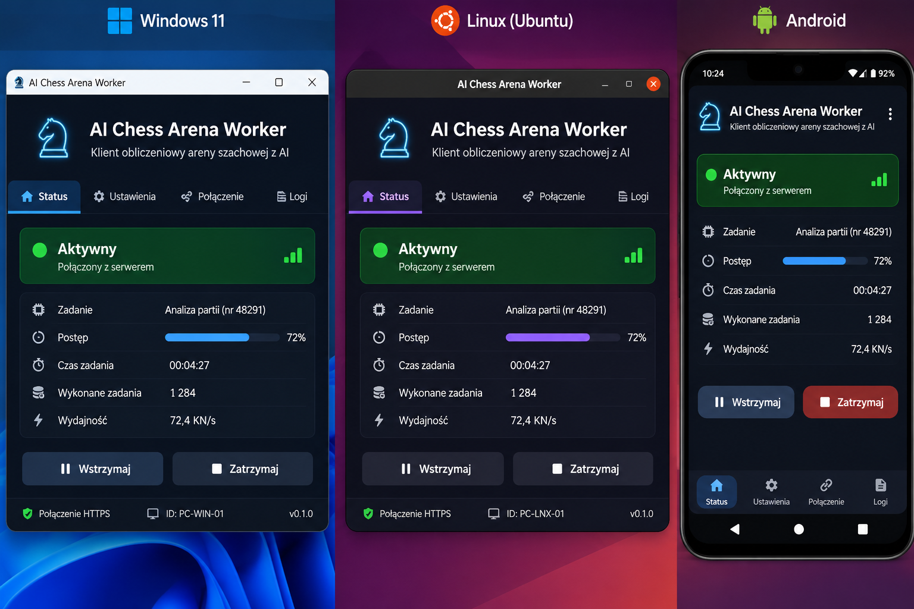

# AI Chess Arena Worker — GUI design reference

[Otwórz oryginalną wizualizację PNG](a_composite_ui_mockup_showing_the_same_ai_chess_a.png)

Oryginalny render PNG został przesłany do gałęzi PR #193. Jest zatwierdzoną referencją wyglądu, a nie zrzutem działającej aplikacji. Wcześniejsze odtworzenie SVG pozostaje wyłącznie pomocniczym materiałem.

Approved concept (22 Nov 2026): a three-panel image showing Windows 11, Linux (Ubuntu) and Android. The concept image was generated in the project conversation; the original PNG is committed in this repository on the PR branch.

## Shared visual direction

- Dark navy background, rounded panels, high contrast light typography, blue/purple accents and green connected status.
- Chess-knight icon and the title **AI Chess Arena Worker**.
- Navigation: **Status**, **Ustawienia**, **Połączenie**, **Logi**.
- Status: HTTPS connection, active job, progress bar, duration, completed tasks and measured performance.
- Controls: **Wstrzymaj** and **Zatrzymaj**; show real state, never pretend a connection or computation is active.
- Windows/Linux: desktop navigation across top, wider two-column layout where space allows, native window decorations.
- Android: narrow vertical layout, touch-friendly controls and bottom navigation.
- Use the same visual language across platforms with platform-native adjustments.

## Implementation boundaries

This is a **target design**, not a screenshot of a functioning worker. The example values (72%, 1,284 tasks, 72.4 KN/s) are illustrative and must not be hard-coded as actual telemetry. The current Tauri prototype does not yet execute remote chess tasks. Implement the interface incrementally after authenticated HTTPS connectivity, scheduler transport, and verified metrics. Android APK and secure Android token storage remain separate follow-up work within Issue #192.
